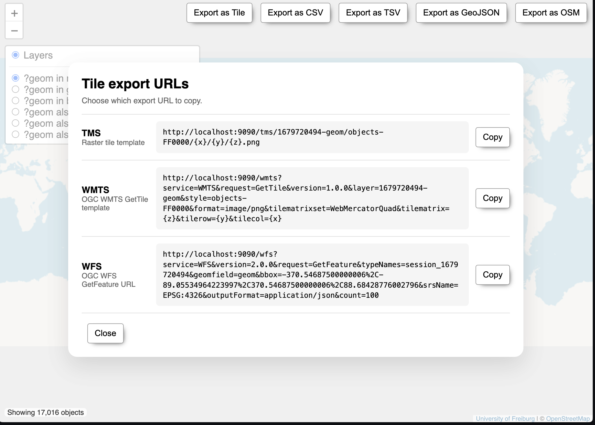
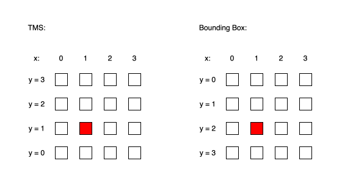
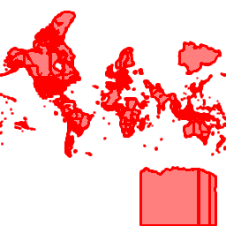
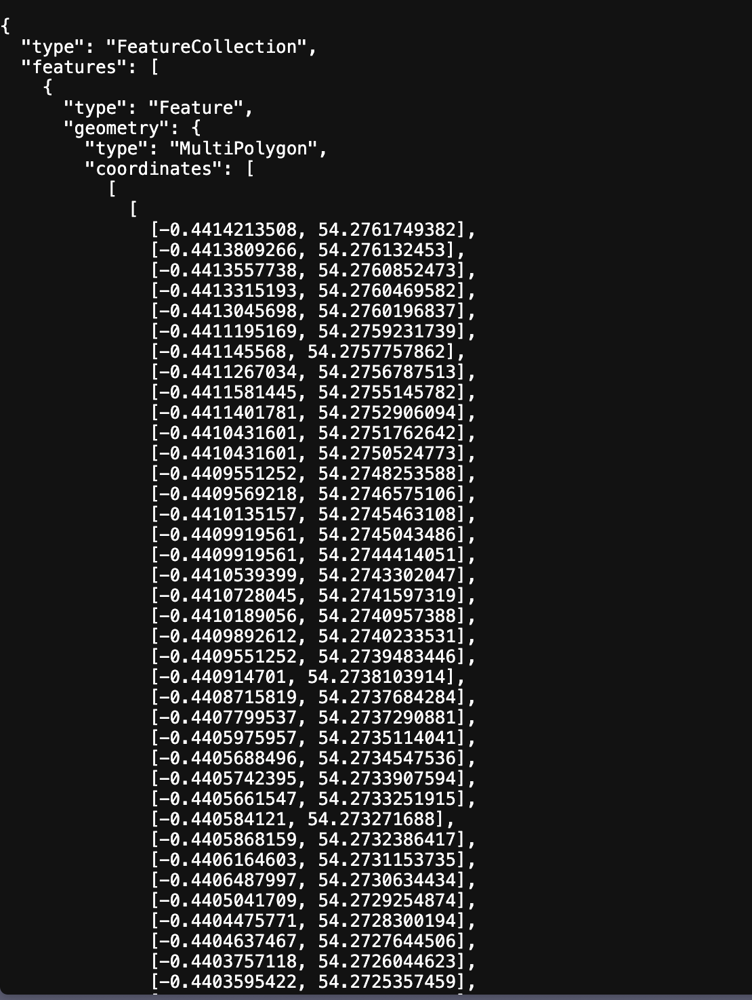

Summary:
This project extends [QLever Petrimaps](https://github.com/ad-freiburg/qlever-petrimaps) with TMS, WMTS, and WFS endpoints for accessing geospatial SPARQL query results. The server processes HTTP requests and reuses existing Petrimaps functionality to return rendered PNG map tiles or GeoJSON features. An export dialog provides service URLs for use by external clients.

<!--more-->

# Content
1. <a href="#general-introduction">Introduction</a>
2. <a href="#relevant-terminology">Background</a>

    2.1. <a href="#term-tms-wmts">TMS and WMTS</a>

    2.2. <a href="#term-wfs">WFS</a>

    2.3. <a href="#term-tiles-layers-crs">Coordinate Reference Systems</a>
3. <a href="#implemented-endpoints">Implemented Endpoints</a>

    3.1. <a href="#tms-endpoints">Tile Map Service (TMS)</a>

    3.2. <a href="#wmts-endpoints">Web Map Tile Service (WMTS)</a>

    3.3. <a href="#wfs-endpoints">Web Feature Service (WFS)</a>
4. <a href="#testing-and-validation">Testing and Validation</a>
5. <a href="#conclusion">Conclusion</a>

* * *

# <a id="general-introduction"></a>1. Introduction
[QLever](https://github.com/ad-freiburg/qlever/) is an open-source engine for querying RDF data with SPARQL. [QLever Petrimaps](https://github.com/ad-freiburg/qlever-petrimaps) allows users to run SPARQL queries and visualize the resulting geospatial data as geometries on an interactive map. Results can also be exported in formats such as CSV, TSV, and GeoJSON.

This project extends Petrimaps with service endpoints that make these results accessible to external GIS (Geographic Information System) applications. Its main contribution is the server-side handling of HTTP requests: the implementation processes request parameters and uses Petrimaps’ existing data and rendering functionality to return map tiles through TMS and WMTS, or geospatial features through WFS. The web interface was also extended to provide the corresponding service URLs.

* * *

# <a id="relevant-terminology"></a>2. Background

## <a id="term-tms-wmts"></a>2.1 TMS and WMTS
TMS (Tile Map Service) and WMTS (Web Map Tile Service) provide access to maps as tiles: images covering specific areas at a given zoom level. Clients can request the tiles needed for the area they display. WMTS also defines a capabilities document that describes the service and its available layers and tile grids.

## <a id="term-wfs"></a>2.2 WFS
WFS (Web Feature Service) provides individual geographic features, including their geometries and associated properties. This allows GIS clients to inspect and process feature data as well as display it.

## <a id="term-tiles-layers-crs"></a>2.3 Coordinate Reference Systems
A coordinate reference system (CRS) defines how coordinates relate to locations on Earth. This project uses `EPSG:4326`, which expresses geographic coordinates in degrees, and `EPSG:3857` (Web Mercator), a projected coordinate system commonly used for web map tiles. The distinction matters when interpreting bounding boxes and converting tile coordinates for rendering.

* * *

# <a id="implemented-endpoints"></a>3. Implemented Endpoints
The TMS, WMTS, and WFS endpoints follow a common request-processing pattern. Petrimaps receives an HTTP request, extracts the relevant values from the URL path or query parameters, and checks the requested operation and its parameters. Depending on the request, the server uses existing session data and rendering functionality or generates service metadata, then returns an appropriate response. The response may be a PNG tile, GeoJSON feature data, or an XML document. The following sections describe the processing specific to each endpoint.

After running a query and selecting a layer, users can open the `Export as Tile` dialog to obtain URLs for TMS, WMTS, and WFS (Figure 1).

<figure style="text-align: center;">
  
  <figcaption>Figure 1: The export dialog provides TMS, WMTS, and WFS URLs for the selected Petrimaps result.</figcaption>
</figure>

## <a id="tms-endpoints"></a>3.1 Tile Map Service (TMS)
The TMS endpoint allows a client to request a rendered tile for a Petrimaps result layer. The web interface provides a URL template using the following path structure:

```text
/tms/{layerId}/{style}/{x}/{y}/{z}.png
```

The `layerId` identifies the session and geometry field to render, while `style` selects the rendering mode and its settings. The handler accepts styles beginning with `heatmap`, `objects`, or `raster`. Style strings can carry additional rendering settings: for example, `objects-FF0000` selects red objects, `heatmap-spectral` selects a heatmap color scheme, and `raster-10x10-spectral` specifies raster cell dimensions and a color scheme. WMTS passes the same style strings to the existing renderer. The coordinates `x` and `y` select a tile in the grid at zoom level `z`. At `z = 0`, one tile covers the whole map. Each increase in zoom level divides every tile into four, producing a grid of `2^z` tiles along each axis. Both `x` and `y` therefore range from `0` to `2^z - 1`: for example, `z = 1` gives a 2 × 2 grid with coordinates from 0 to 1, while `z = 2` gives a 4 × 4 grid with coordinates from 0 to 3. A higher zoom level selects a smaller geographic area per tile.

For a TMS request, the server resolves the layer, checks the style, and converts the tile coordinates to integers before checking their range. Tile coordinates are converted to integers using `atoi`: a non-numeric string such as `abc` is interpreted as `0`, while a numeric prefix such as `1` in `1abc` is accepted.

TMS tile rows use a bottom-origin convention, while Petrimaps' bounding box calculation uses a top-origin row. The server therefore converts the requested row before calculating the tile's extent:

```text
topOriginY = 2^z - 1 - y
```

<figure style="text-align: center;">
  
  <figcaption>Figure 2: Tile coordinates at zoom level 2, comparing TMS and top-origin row numbering.</figcaption>
</figure>

For example, at `z = 2`, the map is divided into a 4 × 4 grid: both `x` and `y` range from `0` to `3`. The highlighted tile has coordinates `(x, y) = (1, 1)` in TMS. Since the top-origin grid counts rows from the top, the same tile is located at `(x, y) = (1, 2)` after the Y-coordinate conversion.

The server then converts the tile coordinates into a bounding box in `EPSG:3857` Web Mercator coordinates.

Rather than introducing a separate rendering pipeline, the endpoint passes the resolved layer, style, bounding box, and a 256 × 256 image size to Petrimaps' existing rendering function. The response is a PNG tile, allowing clients to access the existing map rendering through the tile URL.

As an example, a SPARQL query selects OpenStreetMap relations whose recorded start and end dates include 1 January 1900. The resulting `?geom` field is rendered using the red `objects` style. The following request selects the world-scale tile at `x = 0`, `y = 0`, and `z = 0`; `{layerId}` represents the active session's layer identifier.

```text
/tms/{layerId}/objects-FF0000/0/0/0.png
```

<figure style="text-align: center;">
  
  <figcaption>Figure 3: PNG tile returned by the TMS endpoint for the query result at x = 0, y = 0, and z = 0.</figcaption>
</figure>

## <a id="wmts-endpoints"></a>3.2 Web Map Tile Service (WMTS)
The WMTS endpoint provides two operations. `GetCapabilities` returns an XML document describing the service and its available layers, styles, formats, and tile matrix set. A client can use this information to construct a `GetTile` request, which returns a rendered PNG tile.

A client can request the capabilities document with:

```text
/wmts?service=WMTS&request=GetCapabilities&version=1.0.0
```

The following template requests a tile:

```text
/wmts?service=WMTS&request=GetTile&version=1.0.0&layer={layerId}&style={style}&format=image/png&tilematrixset=WebMercatorQuad&tilematrix={z}&tilerow={y}&tilecol={x}
```

The parameters `service`, `request`, and `version` identify the operation; `layer`, `style`, and `format` specify the result layer and output; and `tilematrixset` selects the tile grid. In this implementation, `tilematrix` identifies the zoom level, `tilerow` the row, and `tilecol` the column.

For `GetTile`, the server checks the parameters, resolves the Petrimaps layer, and converts the tile coordinates to an `EPSG:3857` bounding box. Unlike the bottom-origin TMS row, the WMTS row for `WebMercatorQuad` is already top-origin, so it is passed to the bounding box calculation without the TMS row conversion. As shown in Figure 2, the highlighted tile at TMS `y = 1` has WMTS `tileRow = 2` at zoom level 2. The server then passes the bounding box and style to the existing Petrimaps rendering function.

The implemented `GetTile` interface accepts version `1.0.0`, the `WebMercatorQuad` tile matrix set, and `image/png` output; it renders tiles at 256 × 256 pixels. Like the TMS handler, it uses `atoi` to convert coordinate strings, so malformed input can be interpreted as a number instead of being rejected.

Figure 4 shows a WMTS tile rendered from the same example query result described in Section 3.1.

<figure style="text-align: center;">
  
  <figcaption>Figure 4: Example PNG tile returned by the WMTS endpoint.</figcaption>
</figure>

## <a id="wfs-endpoints"></a>3.3 Web Feature Service (WFS)
In Petrimaps, TMS and WMTS expose a rendered view of the query result as PNG tiles. The WFS endpoint instead returns selected geometries and properties as GeoJSON features, allowing clients to inspect and process the feature data itself. The endpoint implements three operations:

| Operation | Purpose | Response |
| --- | --- | --- |
| `GetCapabilities` | Describe the service and available session-backed feature types | XML |
| `DescribeFeatureType` | Describe the structure of a selected feature type | XML schema |
| `GetFeature` | Retrieve features from a session | GeoJSON |

A client can discover the available feature types with:

```text
/wfs?service=WFS&version=2.0.0&request=GetCapabilities
```

In the current implementation, capabilities advertises feature types as `session_{sessionId}`, but `DescribeFeatureType` checks the supplied name against the unprefixed session ID. Therefore, until this inconsistency is fixed, the schema request uses the session ID without the `session_` prefix:

```text
/wfs?service=WFS&version=2.0.0&request=DescribeFeatureType&typeNames={sessionId}
```

In contrast, `GetFeature` accepts the prefixed form generated by the export dialog, as well as the unprefixed session ID. The difference can prevent clients that use the advertised feature type name from retrieving its schema.

A `GetFeature` request can select a geometry field and restrict the result to a spatial area:

```text
/wfs?service=WFS&version=2.0.0&request=GetFeature&typeNames={typeName}&geomfield={geomField}&bbox={west},{south},{east},{north}&srsName=EPSG:4326&outputFormat=application/json&count=100
```

The parameters used by this request and the optional pagination parameter `startindex` are described below:

| Parameter | Purpose | Example or behavior in this implementation |
| --- | --- | --- |
| `service` | Identifies the service. | `WFS` |
| `version` | Specifies the WFS version. | `2.0.0` |
| `request` | Selects the operation. | `GetFeature` |
| `typeNames` | Identifies the session-backed feature type. | `session_{sessionId}`; `typename` is also accepted. |
| `geomfield` | Selects the geometry field. | If omitted, the first geometry field is used. |
| `bbox` | Restricts the spatial search to a bounding box. | Four coordinates: `minX,minY,maxX,maxY`. |
| `srsName` | Specifies how the bounding box coordinates are interpreted. | `EPSG:3857` uses projected coordinates; other values follow the longitude/latitude path, which also applies when omitted. |
| `outputFormat` | Indicates the requested output format in the example URL. | `application/json`; this handler returns GeoJSON and does not validate this parameter. |
| `count` | Limits the number of features returned. | `100` returns at most 100 features. |
| `startindex` | Sets the starting position in the selected results. | `0` starts at the beginning. |

For a `GetFeature` request, Petrimaps resolves the session and geometry field, applies the requested spatial filter and result limits, and constructs a GeoJSON `FeatureCollection` from the selected geometries and properties. For a bounding box in `EPSG:4326`, the implementation converts its longitude and latitude coordinates to Web Mercator for the spatial search; `EPSG:3857` bounds are used as projected coordinates.

Figure 5 shows the beginning of an example response. The `FeatureCollection` contains a feature with a `MultiPolygon` geometry; the screenshot shows only part of its coordinate array, not the complete response.

<figure style="text-align: center;">
  
  <figcaption>Figure 5: Excerpt from a GeoJSON response returned by the WFS GetFeature operation.</figcaption>
</figure>

The implementation supports the operations and response formats described above; it does not claim to implement every WFS operation or feature. In the current `GetFeature` BBOX handler, values other than the recognized `EPSG:3857` forms follow the longitude/latitude conversion path rather than being strictly rejected as unsupported.

# <a id="testing-and-validation"></a>4. Testing and Validation

The endpoints were exercised using a Petrimaps query result containing OpenStreetMap geometries. The examples in Sections 3.1–3.3 show the responses and the rendering style used for the tile requests.

For TMS, a request for the world-scale tile at `x = 0`, `y = 0`, and `z = 0` returned a PNG image of the query result using the red `objects` style (Figure 3). For WMTS, a `GetTile` request also returned a PNG tile displaying the result (Figure 4). Inspecting these responses confirms that the example requests reached the rendering functionality and produced images; the examples alone do not verify every tile coordinate or style.

For WFS, the `GetFeature` response was inspected as GeoJSON. It contained a `FeatureCollection` with a feature whose geometry was a `MultiPolygon`, as shown in the excerpt in Figure 5. A `DescribeFeatureType` request using the session ID without the `session_` prefix also returned an XML schema. The prefixed type name advertised by `GetCapabilities` returned a “WFS type name not found” error in this example, indicating an inconsistency that needs correction and further testing.

During WFS testing, a request covering a large geographic area and involving many features did not complete before the timeout. A smaller `BBOX` or a lower `count` can limit the requested results, although their effect on processing time depends on the data and implementation.

* * *

# <a id="conclusion"></a>5. Conclusion
This project extended Petrimaps with TMS, WMTS, and WFS endpoints for accessing geospatial query results. The server-side implementation processes HTTP requests and reuses existing Petrimaps data and rendering functionality to return PNG map tiles or GeoJSON features. The web interface was also extended to provide the corresponding service URLs.

Example requests produced rendered tiles and GeoJSON responses. During testing, a WFS request covering a large area and involving many features exceeded the available time. Future work includes investigating the processing cost and timeouts of large WFS requests, testing compatibility with additional external clients, and exploring support for tile image formats such as JPEG alongside PNG.
